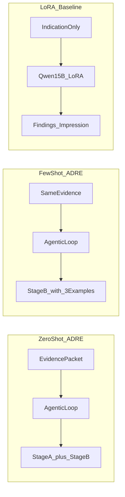

# ADRE-CXR Three-Row Evaluation Report

**Project:** Agentic Document Reasoning for Evidence-Grounded Chest X-Ray Report Generation  
**Dataset:** IU X-Ray (Indiana University / Open-I)  
**Evaluation set:** N = 26 studies (same UIDs across all three rows)  
**Metrics:** BLEU-1/2/3/4, ROUGE-L, METEOR, BERTScore F1 (RoBERTa-large)  
**Ground truth:** radiologist-written Findings + Impression from the IU reports

---

## 1. Why these three rows?

Literature on radiology report generation almost always reports:

1. BLEU-1, BLEU-2, BLEU-3, BLEU-4  
2. ROUGE-L  
3. METEOR  
4. BERTScore  

Our supervisor asked for those metrics under **three generation settings**:

| Row | Name | Question it answers |
|---|---|---|
| 1 | Zero-shot | How well does the full ADRE pipeline work with no examples and no fine-tuning? |
| 2 | Few-shot | Does adding a few style examples in the prompt improve the same ADRE pipeline? |
| 3 | LoRA | How well does a fine-tuned small LLM do when trained on IU-style reports? |

This gives a standard comparison table for presentations and the write-up.

---

## 2. Shared setup (all rows)

### Dataset and split

- **Source:** IU X-Ray on Kaggle (`raddar/chest-xrays-indiana-university`)
- **Frozen splits:** dev = 100, test = 400 (seed = 42)
- **Eval subset:** 26 studies from the frozen held-out list (`data/processed/heldout_uids.json`)
- Studies used for few-shot examples and LoRA training were taken from the **remaining training pool** (not in cold/test), to avoid leakage

### What we evaluate against

For each study, predicted text is compared to:

```text
{ground_truth findings}

{ground_truth impression}
```

### Metrics implementation

Implemented in [`src/eval/metrics.py`](src/eval/metrics.py):

- **BLEU-1..4:** NLTK `corpus_bleu` with smoothing  
- **ROUGE-L:** `rouge-score` F-measure  
- **METEOR:** NLTK METEOR  
- **BERTScore F1:** `bert-score` with `roberta-large`

Outputs are in:

- `outputs/dev_predictions.jsonl` (zero-shot)
- `outputs/fewshot_predictions.jsonl` (few-shot)
- `outputs/lora_predictions.jsonl` (LoRA)
- `outputs/comparison_table.md` / `comparison_table.json` (final table)

---

## 3. Row 1 — Zero-shot (full ADRE pipeline)

### What we did

Run the **complete ADRE-CXR pipeline** for each of the 26 studies, with **no in-prompt examples** and **no fine-tuning**:

1. **Evidence acquisition** (precomputed on Kaggle GPU)  
   - TorchXRayVision DenseNet121 (NIH weights)  
   - 6 lung-zone crops, CLAHE view  
   - Opacity / symmetry / CTR proxy  
   - Quality labels (exposure, inspiration, rotation)  
   - Saved as `data/processed/evidence/{uid}.json`

2. **Guideline retrieval (RAG)**  
   - Fleischner glossary PDF → hierarchical chunks  
   - Hybrid BM25 + FAISS (MiniLM embeddings)

3. **Agentic loop**  
   - Gap analysis against a CXR checklist  
   - Tool planning / consistency checks (Tmax = 12)

4. **Dual-stage generation** (LLM = Llama-3.3-70B via Groq)  
   - Stage A (T = 0.0): structured JSON findings  
   - Stage B (T = 0.25): narrative Findings + Impression  
   - **No few-shot examples** in Stage B

### How it was run

```powershell
python scripts/run_dev_batch.py --split dev --limit 26 --sleep 15
python scripts/rebuild_predictions.py --split dev --reports-dir outputs/reports --output outputs/dev_predictions.jsonl
python scripts/evaluate.py --predictions outputs/dev_predictions.jsonl --split dev
```

### Results (N=26)

| BLEU-1 | BLEU-2 | BLEU-3 | BLEU-4 | ROUGE-L | METEOR | BERTScore F1 |
|---|---|---|---|---|---|---|
| 0.0835 | 0.0257 | 0.0078 | 0.0020 | 0.0980 | 0.1137 | **0.8311** |

### Interpretation

- Strong **semantic** similarity (BERTScore ~0.83) means the reports are often “in the right medical neighborhood”
- Low **surface** BLEU/ROUGE means wording often differs from IU radiologist style (pipeline tends to overcall pathologies from DenseNet scores)
- This is the pure ADRE zero-shot evidence-grounded baseline

---

## 4. Row 2 — Few-shot (same ADRE pipeline + 3 examples)

### What we did

Same ADRE pipeline as zero-shot (same evidence packets, same RAG, same agentic loop, same Groq Llama-3.3-70B), with **one change**:

In Stage B narrative generation, we prepended **3 fixed report examples** taken from the training pool (UIDs 5, 45, 7 — outside held-out splits):

1. Normal chest report  
2. Cardiomegaly report  
3. Atelectasis report  

Implemented in [`src/generation/stage_b_narrative.py`](src/generation/stage_b_narrative.py) via `use_few_shot=True` / `--few-shot`.

Purpose: teach the LLM the **brief IU Findings/Impression style** without updating model weights.

### How it was run

```powershell
python scripts/run_dev_batch.py --split dev --limit 26 --few-shot --sleep 15
python scripts/rebuild_predictions.py --split dev --reports-dir outputs/reports_fewshot --output outputs/fewshot_predictions.jsonl
python scripts/evaluate.py --predictions outputs/fewshot_predictions.jsonl --split dev
```

(Reports stored under `outputs/reports_fewshot/`. Multiple Groq free-tier keys were rotated when rate limits hit.)

### Results (N=26)

| BLEU-1 | BLEU-2 | BLEU-3 | BLEU-4 | ROUGE-L | METEOR | BERTScore F1 |
|---|---|---|---|---|---|---|
| 0.1120 | 0.0477 | 0.0220 | 0.0086 | 0.1276 | 0.1309 | **0.8389** |

### Interpretation

- Improves **all** metrics vs zero-shot
- Gains are modest (BERTScore +0.008) but consistent — examples help tone/structure more than they fix evidence overcalling
- Still the same ADRE evidence-grounded architecture; only prompting changed

---

## 5. Row 3 — LoRA fine-tuning

### What we did

This row is a **fine-tuned LLM baseline**, not the full ADRE evidence pipeline.

- **Task:** `indication → FINDINGS + IMPRESSION`
- **Training data:** IU reports **not** in cold/test (~2.8k usable studies after filtering)
- **Model:** `Qwen/Qwen2.5-1.5B-Instruct` (open; Llama-3.2-1B was gated on Hugging Face)
- **Method:** LoRA / QLoRA-style PEFT on Kaggle GPU  
  - `r=16`, `lora_alpha=32`, targets `q_proj` / `v_proj`  
  - 3 epochs, max sequence length 512
- **Inference:** same 26 eval UIDs, indication only as input
- Notebook: [`notebooks/02_lora_finetune.ipynb`](notebooks/02_lora_finetune.ipynb)  
- Predictions: `outputs/lora_predictions.jsonl`

This matches common “fine-tuned text generator” baselines in report-generation papers, and is deliberately different from ADRE’s multi-modal evidence + RAG + agent design.

### How it was evaluated

```powershell
python scripts/evaluate.py --predictions outputs/lora_predictions.jsonl --split dev
python scripts/build_comparison_table.py
```

### Results (N=26)

| BLEU-1 | BLEU-2 | BLEU-3 | BLEU-4 | ROUGE-L | METEOR | BERTScore F1 |
|---|---|---|---|---|---|---|
| 0.2443 | 0.1672 | 0.1245 | 0.0955 | 0.3221 | 0.2647 | **0.8863** |

### Interpretation

- Best on **every** metric
- Large gains on BLEU/ROUGE/METEOR show LoRA learned IU **phrasing and template style**
- Important caveat for the paper/presentation: LoRA does **not** use CXR image evidence, zone pathology scores, or guidelines — it is a text-style baseline. Higher lexical overlap does not automatically mean better clinical grounding.

---

## 6. Final comparison table

| Setting | N | BLEU-1 | BLEU-2 | BLEU-3 | BLEU-4 | ROUGE-L | METEOR | BERTScore F1 |
|---|---|---|---|---|---|---|---|---|
| Zero-shot (ADRE) | 26 | 0.0835 | 0.0257 | 0.0078 | 0.0020 | 0.0980 | 0.1137 | 0.8311 |
| Few-shot (ADRE + 3 examples) | 26 | 0.1120 | 0.0477 | 0.0220 | 0.0086 | 0.1276 | 0.1309 | 0.8389 |
| LoRA (Qwen-1.5B fine-tune) | 26 | **0.2443** | **0.1672** | **0.1245** | **0.0955** | **0.3221** | **0.2647** | **0.8863** |



---

## 7. What to say in the presentation (short)

1. We adapted ADRE from EEG → chest X-ray on IU X-Ray.  
2. We evaluated on standard NLG metrics for **three settings**.  
3. **Zero-shot ADRE** already reaches BERTScore ~0.83 with no training.  
4. **Few-shot** helps a bit by matching report style.  
5. **LoRA** scores highest on lexical metrics because it is trained on IU report text, but it is a different setup (no image evidence pipeline).  
6. Next work can scale to the full test split (N=400) and/or add ablations of ADRE components.

---

## 8. Files reference

| Item | Path |
|---|---|
| Metrics code | `src/eval/metrics.py` |
| Zero-shot reports | `outputs/reports/` |
| Few-shot reports | `outputs/reports_fewshot/` |
| LoRA notebook | `notebooks/02_lora_finetune.ipynb` |
| Comparison table | `outputs/comparison_table.md` |
| Held-out UID list | `data/processed/heldout_uids.json` |
